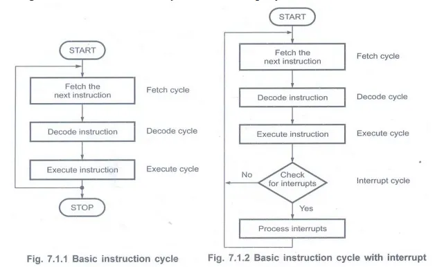
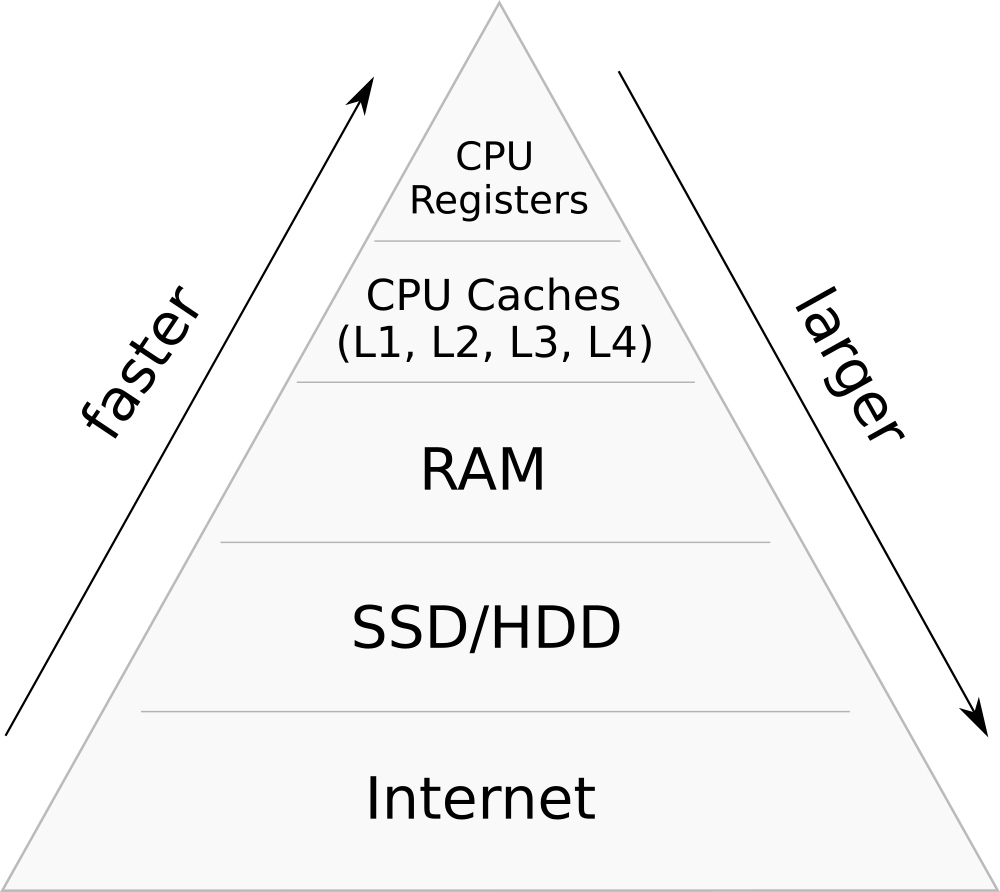
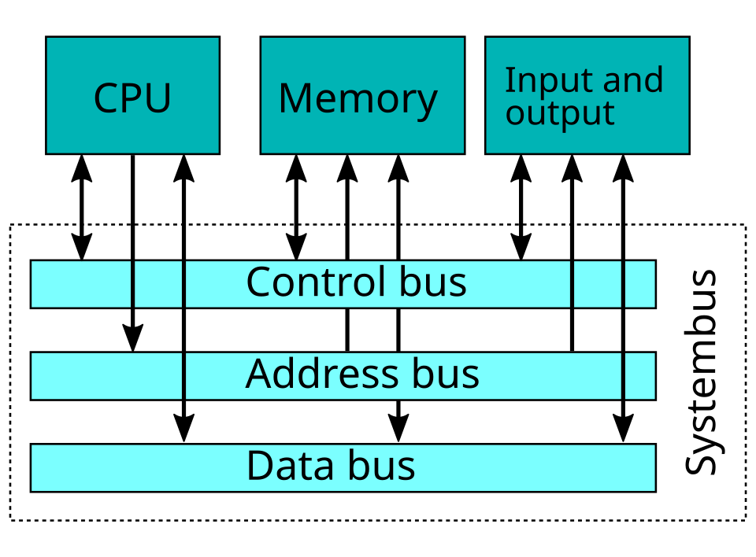
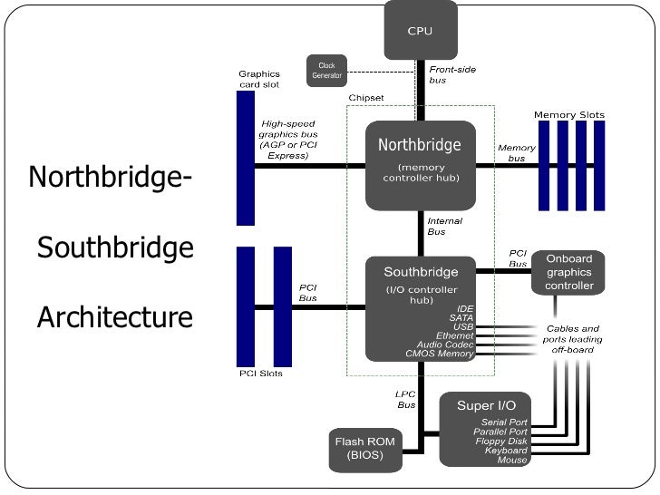
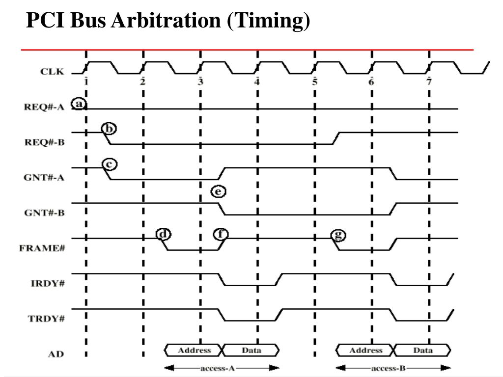

# Операционни системи - Увод

---

# Процесорът

---

##  Какво е процесор?

- "мозъкът" на компютъра
- изпълнява програми
- производители: Intel, AMD

---

**Фиг. 1 Intel Core i9 (отпред)**

---

**Фиг. 2 Intel Core i9 (отзад)**

---

## Процесор - Структура

- **Контролна единица**
- **Единица за аритметична логика (ALU)**
- **Регистри**
- Компонентите са свързани чрез **шини**

---

**Фиг. 3 Структура на CPU**

---

## Регистри

- **Програмен брояч (PC)**
- **Регистър на инструкциите (IR)**
- **Други**

---

## Data path

- наборът от компоненти на процесора, които отговарят за изпълнението на операции.
- регистрите, ALU  и шините, които ги свързват
- процесорът има два входни регистъра и един изход

---

**Фиг. 4 Data Path**

---

## Видове инструкции

- **регистър-памет** - взима думи от паметта или ги връща обратно
- **регистър-регистър** - взима операнди от регистрите, изпълнява операция и връща резултат

---

## Fetch-Decode-Execute - 1/2

1. Извлечи следващата инструкция от паметта и я сложи в регистъра на инструкциите
2. Промени програмният брояч да сочи към следващата инструкция
3. Определи типът на извлечената инструкция
4. Ако инструкцията използва дума от паметта, определи къде е

---

## Fetch-Decode-Execute - 2/2

5. Извлечи думата, ако е нужно, и я сложи в регистър
6. Изпълни инструкцията
7. Върни се на стъпка 1

---

## Симулация

[Симулация на цикъла Fetch/Decode/Execute](https://www.hartismere.com/Curriculum/Computer-Science/GCSE-Computer-Science/CPU-Fetch-Decode-Execute-Animation)

---

## Прекъсвания

- Сигнал към процесора, че се е случило събитие, което изисква незабавно внимание
- Изпраща се от хардуер (I/O устройство, таймер) или софтуер (грешка, системно повикване)
- След всяка изпълнена инструкция процесорът проверява дали има чакащо прекъсване

---

## Обработка на прекъсване

1. Процесорът запазва текущото си състояние (регистри, програмен брояч)
2. Скача към програма, наречена **прекъсващ вектор (interrupt handler)**, специфична за съответното прекъсване
3. Обработващата програма се изпълнява
4. Процесорът възстановява запазеното състояние и продължава изпълнението от мястото, където е спрял

---

**Фиг. 9 Нормален цикъл срещу цикъл на прекъсване**

---

## Памет

---

## Какво е памет?

- Частта на компютъра, където програми и данни се запазват.
- Без памет, от която процесорите да четат и да пишат информация, няма да съществуват компютри със запазени програми.

---
## Бит

- Основната паметна единица.
- Двоична цифра. Може да бъде 0 или 1.
- Най-ефикасният начин за представяне на данни

---

## Бит в реалност

**Фиг. 5 Електричен сигнал, който представлява поредица от битове**

---
## Адреси  - 1/2

- Паметта е съставена от набор от **клетки**.
- Всяка клетка има номер, наречен нейният **адрес**.
- Памет с n клетки ще имат адрес от 0 до n-1
- Всички клетки съдържат еднакъв брой битове
- Клетка с _k_ битове може да съдържа $2^k$ различни стойности

---

**Фиг 6. Различни начини да се подреди 96-битова памет**

---

## Адреси - 2/2

- Адресите се изразяват като двоични числа
- Адрес с m бита => $2^m$ адресируеми клетки
- Памет с $2^{12}$ клетки се нуждае от 12-битов адрес

---

## Байт

- клетка, състояща се от 8 бита
- стандартната клетка за всички компютри
- най-малката адресируема единица на компютъра

---

## Дума - 1/2

- начин за групиране на байтове
- 32-битова дума => 4 байта
- 64-битова дума => 8 байта

---
## Дума - 2/2

- процесорните инструкции работят върху цели думи
- регистрите на процесора имат размер една дума
- размерът на думата определя какъв е компютъра
- 32-битов компютър => 32-битови регистри и инструкции за манипулиране на 32-битови думи

---

## Йерархия на паметта

- Различните видове памет предлагат компромис между скорост, цена и обем
- От най-бърза (и най-скъпа) към най-бавна (и най-евтина): регистри → кеш памет → оперативна памет (RAM) → твърд диск/SSD

---

**Фиг. 10 Йерархия на паметта**

---

## Кеш памет

- Малка и бърза памет между процесора и RAM
- Съхранява често използвани данни и инструкции, за да намали броя достъпи до по-бавната RAM
- Основава се на принципа за **локалност** - програмите често използват едни и същи данни или съседни адреси

---

## Оперативна памет (RAM)

- Основната памет на компютъра - тук се зареждат изпълняващите се програми и данните им
- Бърза, но по-бавна от кеша и регистрите; **изчезва**, когато липсва захранване (волатилна)
- Достъпът е произволен - всяка клетка (байт) има собствен адрес и се достъпва за еднакво време

---

## Вторична памет

- Диск (HDD) или SSD - памет, която пази данните трайно, дори без захранване
- Много по-бавна от RAM, но с много по-голям капацитет и по-ниска цена за байт
- Използва се за постоянно съхранение на файлове и програми, докато не бъдат заредени в RAM за изпълнение

---

# Вход-Изход

---

## Какво е входно изходно устройство?

- Устройства като клавиатура и мишка.
- Всяко I/O  устройство съдържа контролер, с който да комуникира с компютъра.

---

**Фиг. 7 Клавиатура**

---

**Фиг 8. Mишка**

---

# Шини

---

## Шини

- процесорът, паметта и входно/изходните портове са интересни компоненти, но не могат да направят нищо полезно.
- шините служат за връзка между процесора, паметта, I/O и др.
- има три основни шини: адресна шина, шина за данни, контролна шина

---

## Видове шини

- Адресна шина: това определя мястото в паметта, от което процесорът ще чете или записва данни.
- Шина за данни: съдържа съдържанието, което е прочетено от или трябва да бъде записано в паметта.
- Контролна шина: това управлява информационния поток, като показва дали операцията е четене или запис и гарантира, че операцията се извършва в точното време.

---

**Фиг. 11 Опростена еднoшинна архитектура**

---

## Множество шини

- Съвременните компютри рядко използват само една шина - тя би била "тясното гърло", през което трябва да мине всяка комуникация.
- Вместо това има йерархия от шини: бърза локална шина между процесора и кеш паметта, шина към основната памет и по-бавни шини към I/O устройствата.
- **Мостове (bridges)** свързват отделните шини помежду им и позволяват на устройства от различни шини да комуникират.

---

**Фиг. 12 Йерархия от шини в модерна система**

---

## Ширина и честота на шината

- **Ширина** - брой линии (проводници), по които шината пренася бита едновременно. По-широка шина пренася повече данни наведнъж, но е по-скъпа за производство.
- **Честота** - колко пъти в секунда шината може да извърши трансфер.
- Пропускателна способност на шината ≈ ширина × честота

---

## Арбитраж на шината

- Само едно устройство може да използва шината в даден момент.
- Когато процесорът, DMA контролерите и I/O устройствата поискат достъп до шината едновременно, се налага арбитраж.
- **Арбитър на шината (bus arbiter)** решава кое устройство става "master" на шината и получава право да я използва.
- Целта е да се избегнат конфликти и повредени данни от едновременен достъп.

---

**Фиг. 13 Пример за арбитраж на шината**

---

## Примери за шини

- **PCI / PCIe** - свързва разширителни карти (графична карта, мрежова карта) с процесора и паметта
- **USB** - универсална серийна шина за периферни устройства (клавиатура, мишка, флаш памет)
- **SATA** - шина за свързване на твърди дискове и SSD-та
