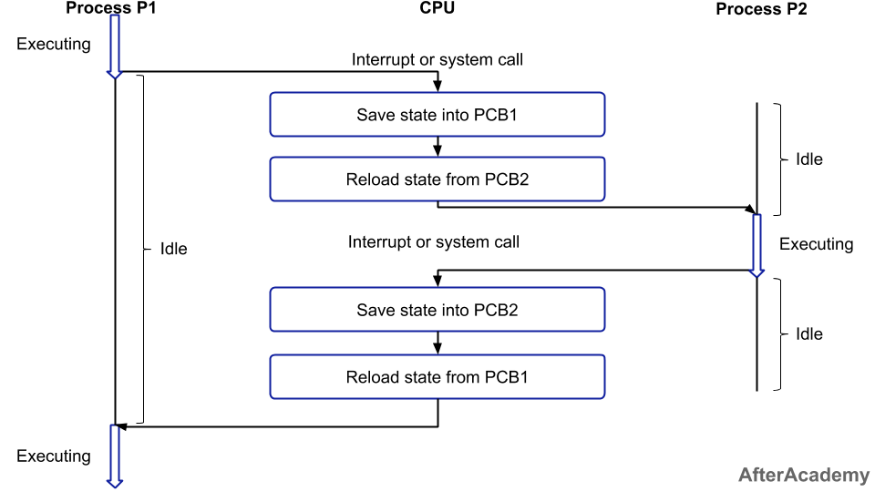

# Операционната система

---

# Какво е операционна система?

---

## Припомняне - какво имаме в компютъра

- Процесор - изпълнява инструкции по цикъла fetch-decode-execute
- Памет - регистри, кеш, RAM и диск, с различна скорост, цена и обем
- Вход-изход - устройства, всяко със свой контролер
- Шини - свързват всички компоненти помежду им
- Прекъсвания - сигнали, чрез които хардуерът привлича вниманието на процесора

---

## Голият хардуер

- Хардуерът сам по себе си може само да изпълнява прости машинни инструкции
- Не знае какво е "програма", "файл", "прозорец" или "потребител"
- Всяко устройство се управлява по различен начин
	- различни контролери, различни регистри, различни команди
- Работата директно с хардуера е сложна, бавна и податлива на грешки

---

## Пример - запис на един файл

- Без операционна система програмистът трябва сам да:
	- разбере как конкретният диск приема команди през своя контролер
	- избере кои блокове на диска са свободни и да ги следи къде какво е записал
	- обработи прекъсването, когато дискът приключи
	- се справи с грешки и различни модели дискове
- Това се повтаря за всяка програма и за всяко устройство
- С операционна система: `write(file, data)`

---

## Проблем 1 - Сложност

- Хардуерът е труден за програмиране и различен при всяка машина
- Нужен е удобен и еднакъв начин за използването му
- Решение: ОС скрива детайлите зад по-проста абстракция
	- вместо дискови блокове - файлове
	- вместо физическа памет - адресно пространство
	- вместо конкретен процесор - процеси

---

## Проблем 2 - Споделяне

- Компютърът има един процесор, ограничена памет и малко устройства, но много програми, които ги искат едновременно
- Ако всяка програма сама си взима ресурси:
	- една програма може да заеме процесора завинаги
	- две програми могат да записват в едни и същи адреси в паметта
	- две програми могат да пишат едновременно на принтера и да смесят резултата
- Нужен е арбитър, който разпределя ресурсите - подобно на арбитража на шината, но за целия компютър

---

## Проблем 3 - Защита

- Програмите могат да съдържат грешки или да са зловредни
- Грешка в една програма не бива да срине цялата система или да повреди данните на други програми и потребители
- Нужен е механизъм, който налага правила и изолира програмите
	- процесорът поддържа два режима на работа: **потребителски** (ограничен) и **привилегирован** (kernel mode)
	- само ОС работи в привилегирован режим и има пълен достъп до хардуера
	- програмите искат услуги от ОС чрез системни извиквания (подробно в следващия урок)

---

## Историческа справка

- Първите компютри нямат ОС - една програма, зареждана и управлявана ръчно от оператор
- Времето на скъпите машини е ценно и процесорът стои неизползван, докато чака вход-изход
	- пакетна обработка: подред изпълняване на задачи без намеса на човек
	- мултипрограмиране: докато една програма чака I/O, процесорът изпълнява друга
	- разделяне на времето: много потребители работят "едновременно" на един компютър
- Всяка стъпка налага нови функции на ОС - разпределяне на памет, планиране, защита

---

## Видове операционни системи

- **Пакетни** - задачите се изпълняват една след друга, без интерактивност
- **С разделяне на времето** - много интерактивни потребители (Linux, Windows, macOS)
- **Реално време (RTOS)** - гарантират, че задачата ще приключи в срок (авионика, медицинска апаратура)
- **Вградени (embedded)** - в рутери, автомобили, уреди; с малко памет и енергия
- **Мобилни** - Android, iOS; с акцент върху батерията и сензорите
- **Разпределени** - множество машини, които работят като една система

---

## Какво е операционна система?

- Софтуер, който управлява хардуера и стои между програмите и хардуера
- Ядрото (kernel) е частта, която работи постоянно в привилегирован режим
- Две гледни точки:
	- **Разширена машина (отгоре надолу)** - предоставя удобна абстракция върху хардуера
	- **Мениджър на ресурси (отдолу нагоре)** - разпределя процесор, памет, диск и устройства между програмите
- Обикновено ОС включва и помощни програми (команден интерпретатор, файлов мениджър), но ядрото е същината ѝ

---

## ОС, ядро и дистрибуция

- **Ядро** - програмата, която управлява хардуера (например Linux)
- **Операционна система** - ядрото плюс основните помощни програми и библиотеки
- **Дистрибуция** - готов пакет от ядро, програми и инсталатор (Ubuntu, Debian, Fedora)
- Примери за ОС: Windows, macOS, Linux, Android
	- Android използва ядрото на Linux, но с различна потребителска част
- В курса ще работим предимно с Linux

---

## Как стартира компютърът

- Ядрото не е "винаги там" - някой трябва да го зареди в паметта
- Ред на стартиране: фърмуер (BIOS/UEFI) -> boot loader -> ядро -> потребителски програми
	- фърмуерът се изпълнява при включване, проверява хардуера и намира диска
	- boot loader-ът зарежда ядрото от диска в паметта
	- ядрото инициализира устройствата и стартира първата потребителска програма
- От този момент ядрото работи в привилегирован режим, докато компютърът е включен
- Ще разгледаме темата по-подробно в следващия урок


<!-- TODO: изображение - стъпките BIOS/UEFI -> Boot loader -> Kernel -> User apps -->

---

## Слоеве в компютърната система

1. Хардуер (процесор, памет, устройства)
2. Операционна система (ядро)
3. Приложни програми (браузър, редактор, игри)
4. Потребител

- Всеки слой използва само услугите на слоя под него

---

## Нуждата от ОС - обобщение

- Хардуерът е сложен -> ОС го **опростява** (абстракция)
- Ресурсите са ограничени -> ОС ги **разпределя** справедливо
- Програмите си пречат -> ОС ги **изолира** и защитава
- В следващите слайдове разглеждаме как ОС постига това

---

# Операционна Система - Функции

---

## Какво прави операционната система?

- Улеснява изпълнението на програмите
	- зарежда програмата в паметта, стартира я и следи изпълнението ѝ
	- програмистът не се грижи за детайлите на хардуера
- Разпределя ресурси между програмите
	- ресурси: процесорно време, памет, дисково пространство, мрежа
	- решава коя програма, кога и колко ресурс да получи
- Прави връзка между програми и устройства
	- програмите не комуникират директно с хардуера (клавиатура, диск, мрежова карта)
	- ОС го прави чрез драйвери, които крият разликите между устройствата

---

## Виртуализация - 1/2

- Взима физически ресурс и го трансформира в по-обща, мощна и лесна за използване виртуална форма
	- физическият ресурс е ограничен и сложен за управление (например един процесор, ограничена памет)
	- виртуалната форма изглежда по-проста и по-"щедра" - всяка програма си мисли, че разполага с цялата машина
- ОС понякога се нарича виртуална машина (в смисъл на абстракция, не като VirtualBox или VMware - тях ще видим в темата за виртуализация)
	- създава илюзията, че всяка програма работи на собствен компютър
	- реалните детайли остават скрити зад по-удобен модел

---

## Виртуализация - 2/2

- Предоставя интерфейс, чрез който потребителите могат да достъпват различни функционалности
	- интерфейсът се състои от няколко стотин системни извиквания (system calls)
	- примери: стартиране на процес, четене и запис във файл, заделяне на памет
- Системните извиквания са интерфейсът на ядрото към програмите
	- програмите рядко ги викат директно - обикновено ползват стандартна библиотека (libc)
	- библиотеката предоставя готови функции, които вътрешно правят системните извиквания
	- това прави програмите по-лесни за писане и преносими между различни машини
- Разликата между API и системно извикване ще разгледаме в следващия урок

---

## Мениджър на ресурси

- Много програми искат достъп до едни и същи ресурси едновременно
	- например няколко програми едновременно ползват процесора, паметта и диска
	- без контрол те биха си пречили или биха повредили данните една на друга
- Операционната система разпределя ресурсите по справедлив и ефективен начин
	- справедливо: никоя програма не бива да "гладува" и да не получава ресурси
	- ефективно: ресурсите не стоят неизползвани, а се оползотворяват максимално
	- ОС затова е и мениджър на ресурсите (resource manager)

---

## Програма и процес

- **Програма** - изпълним файл на диска; пасивна, само инструкции и данни
- **Процес** - изпълняваща се програма; има памет, регистри, отворени файлове
- Една програма може да е няколко процеса едновременно
	- например два прозореца на един и същ редактор
- ОС създава, следи и прекратява процесите


<!-- TODO: изображение - един файл на диска -> два процеса в паметта със собствено състояние -->

---

## Виртуализация на процесор

- няколко процеса могат да работят "едновременно"
	- всеки процес си мисли, че има собствен процесор за себе си
	- в действителност има само един (или малко на брой) физически процесори/ядра
- ОС постига това чрез споделяне на времето (time sharing)
	- процесорът се дава на един процес за много кратък интервал (милисекунди)
	- след това ОС го превключва към следващия процес (context switch)
	- превключването е толкова бързо, че потребителят го възприема като истинска паралелна работа
- Обикновено има повече процеси, отколкото ядра
	- планировчикът (scheduler) решава кой процес кога да работи
	- ОС запазва и възстановява състоянието на процеса при всяко превключване

---


---

## Пример - cpu.c

```c
int main(int argc, char *argv[]) {
    char *str = argv[1];
    while (1) {
        printf("%s\n", str);
        sleep(1);
    }
    return 0;
}
```

```bash
gcc -o cpu cpu.c
./cpu A & ./cpu B & ./cpu C &
```

- Три процеса от една и съща програма работят "едновременно"
- Изходът се редува (A, B, C, ...), макар да има само по няколко ядра
- Спиране: `kill %1 %2 %3`

---

## Прекъсвания и контрол върху процесора

- Ако процесът държи процесора, как ОС го взима обратно?
- Хардуерен **таймер** генерира прекъсване през равни интервали (милисекунди)
	- процесорът спира текущия процес и предава управлението на ядрото
	- ядрото решава дали да продължи същия процес или да превключи към друг
- Така програма в безкраен цикъл не може да блокира системата
- Други прекъсвания: дискът е приключил, натиснат е клавиш, дошъл е мрежов пакет


<!-- TODO: изображение - времева линия: процес A -> таймерно прекъсване -> ядро (context switch) -> процес B -->

---

## Механизъм и политика

- **Механизъм** - *как* се прави нещо
	- пример: context switch - запазване и възстановяване на състоянието на процеса
- **Политика** - *какво* да се направи
	- пример: планировчикът избира кой процес да работи следващ
- Разделението позволява да сменяме политиката, без да пипаме механизма
	- различни цели (интерактивност или пропускателна способност) - различни политики

---

## Виртуализация на паметта

- всяка програма има своя собствена "виртуална" памет - наречена адресно пространство
- операционната система мапва всяко адресно пространство върху реалната памет
	- адресите, които програмата вижда, са виртуални; ОС (с помощта на хардуера) ги превежда във физически
	- два процеса могат да ползват един и същ виртуален адрес, без да си пречат, защото той сочи към различно място във физическата памет
- Предимства
	- изолация (isolation): един процес не може да чете или променя паметта на друг
	- удобство: програмистът не се грижи къде точно в реалната памет се намират данните му
	- ефективност: ОС може да ползва диска като допълнително място, когато паметта се напълни (swapping)

---


---

## Пример - mem.c

```c
int *p = malloc(sizeof(int));
printf("(%d) address pointed to by p: %p\n", getpid(), p);
*p = 0;
while (1) {
    sleep(1);
    *p = *p + 1;
    printf("(%d) p: %d\n", getpid(), *p);
}
```

```bash
./mem & ./mem &
```

- Двата процеса печатат **един и същ адрес**, но всеки увеличава собствения си брояч
- Адресът е виртуален - сочи към различно място във физическата памет

---

## Пример - mem.c и ASLR

- ОС по подразбиране разбърква адресите на всяко стартиране (ASLR - за сигурност)
- За демото го изключваме, за да се вижда еднакъв адрес

```bash
# изключване на ASLR (Linux)
sudo sysctl -w kernel.randomize_va_space=0

# включване отново
sudo sysctl -w kernel.randomize_va_space=2
```

---

## Паралелност

- В една програма се случват няколко неща едновременно
	- програмата се разделя на няколко нишки (threads), които работят "паралелно"
	- нишките на една програма споделят една и съща памет
- Паралелността създава проблеми и в самите програми
	- ако две нишки едновременно променят една и съща данна, резултатът може да е грешен (race condition)
	- пример: две нишки увеличават брояч с 1 - и двете прочитат старата стойност и записват еднаква нова, така че едното увеличение се губи
	- програмистът трябва да синхронизира нишките (например с ключалки - locks)
- ОС предоставя средства за създаване и синхронизиране на нишки

---


---

## Паралелност и паралелизъм

- **Concurrency** (паралелност) - няколко задачи напредват в припокриващи се интервали
	- може да е на едно ядро, чрез бързо превключване
- **Parallelism** (паралелизъм) - няколко задачи се изпълняват буквално в един и същ момент
	- изисква повече от едно ядро
- Нишките ни дават и двете, но проблемите със споделената памет са едни и същи

---

## Пример - thread.c без синхронизация

```c
volatile int counter = 0;
int loops;

void *worker(void *arg) {
    for (int i = 0; i < loops; i++) {
        counter++;
    }
    return NULL;
}
```

```bash
./thread 100000
Initial value : 0
Final value   : 143012   # очаквахме 200000
```

- Две нишки, всяка увеличава брояча `loops` пъти
- `counter++` не е една стъпка: прочети, увеличи, запиши
- Резултатът е различен при всяко пускане (стойностите са примерни)

---

## Пример - thread.c със заключване

```c
pthread_mutex_t mymutex = PTHREAD_MUTEX_INITIALIZER;

void *worker(void *arg) {
    for (int i = 0; i < loops; i++) {
        pthread_mutex_lock(&mymutex);
        counter++;
        pthread_mutex_unlock(&mymutex);
    }
    return NULL;
}
```

```bash
./thread 100000
Initial value : 0
Final value   : 200000
```

- Само една нишка може да е в критичната секция
- Цената: заключването забавя програмата

---

# Постоянство

---

## Постоянство

- Дълготрайна информация се пази в диска
	- паметта (RAM) е нетрайна - данните в нея се губят при изключване на компютъра
	- дисковете (HDD, SSD) запазват данните и след изключване
- ОС управлява тази информация чрез файлова система
	- организира данните във файлове и директории
	- грижи се данните да не се губят и да не се повреждат (например при внезапно спиране на тока)

---


---
## Файлова система

- ОС споделя информацията между файловете
	- различни програми могат да четат и пишат в едни и същи файлове
	- файловата система е споделена и се грижи за достъпа до нея
- Файловата система е абстракция над диска
	- програмата работи с имена на файлове, а не със сектори и блокове на диска
	- ОС превежда операциите (отваряне, четене, запис, затваряне) в реални операции върху хардуера
- Пример: Създаване на програма
	- редакторът записва изходния код във файл
	- компилаторът чете този файл и записва изпълним файл
	- шелът (командният интерпретатор) стартира изпълнимия файл, а ядрото го зарежда в паметта, за да се изпълни

---

```bash
nano main.c #създаване на програма
gcc -o main main.c #компилиране на програма
./main #изпълняване на програма
```

---


---


---


---


---

## Пример - io.c

```c
int fd = open("/tmp/file.txt", O_WRONLY | O_CREAT | O_TRUNC, S_IRUSR | S_IWUSR);
char buffer[20];
sprintf(buffer, "hello world\n");
write(fd, buffer, strlen(buffer));
fsync(fd);
close(fd);
```

- `open`, `write`, `close` са системни извиквания - искания към ядрото
- `fsync` принуждава данните да стигнат до диска, а не да останат в паметта
- Програмата работи с файл и име, а не със сектори на диска

---

## Как да видим системните извиквания

- Инструментът `strace` показва всяко системно извикване на програма (Linux)

```bash
gcc -o io io.c
strace ./io
```

```
openat(AT_FDCWD, "/tmp/file.txt", O_WRONLY|O_CREAT|O_TRUNC, 0600) = 3
write(3, "hello world\n", 12)            = 12
fsync(3)                                = 0
close(3)                                = 0
```

- Връщаме се към `write(file, data)` от началото - това е системно извикване
- Ще разгледаме системните извиквания в следващия урок

---
## ОС - Цели 1/2

1. Абстракция
2. Производителност
3. Сигурност
4. Надеждност

---
## Абстракция

-  Операционната система улеснява създаването и използването на софтуер
- Скрива много от съществените процеси
- Пример: виртуализация на паметта, файлова система, т.н
---

## Производителност

- Премахване на ненужни разходи
- Често влиза в конфликт с абстракцията
	- пример: виртуалната памет е удобна, но всяко превеждане на адрес струва време
	- пример: файловата система е удобна, но е по-бавна от директен достъп до диска

---

## Сигурност

- Защита на приложенията едно от друго
- Защита между приложенията и ОС
- Основен принцип при защитата е изолацията

---

## Надеждност

- ОС трябва да работи нон-стоп
- Крашнала ОС трябва да може да се възстанови

---
## ОС - Цели 2/2

5. Енергоефективност
6. Преносимост

---

## Енергоефективност

- ОС управлява енергоспестяващите режими на устройствата (sleep, hibernate)
- Балансира производителност срещу консумация на батерия

---

## Преносимост

- ОС трябва да работи на различни хардуерни платформи (x86, ARM) и форм-фактори (сървъри, телефони, вградени системи)
- Програмите също не трябва да се пренаписват за всяка машина
- Примери: Linux работи на сървъри, телефони (Android), рутери и суперкомпютри

---

## Обобщение

- ОС **опростява** хардуера (абстракция), **разпределя** ресурсите и **изолира** програмите
- Виртуализира процесора (процеси) и паметта (адресни пространства)
- Предоставя средства за паралелност и постоянство (файлова система)
- Целите често си противоречат: абстракция, производителност, сигурност, надеждност, енергоефективност, преносимост
- Следва: компоненти на ОС - ядро, системни повиквания, потребителски интерфейс

---

## Въпроси

- Защо не можем да оставим всяка програма да управлява хардуера сама?
- Каква е разликата между програма и процес?
- Как ОС взима процесора от програма в безкраен цикъл?
- Защо два процеса могат да ползват един и същ виртуален адрес?
- Кога `counter++` в две нишки дава грешен резултат и как се предотвратява?
- Каква е разликата между ядро, операционна система и дистрибуция?

---
