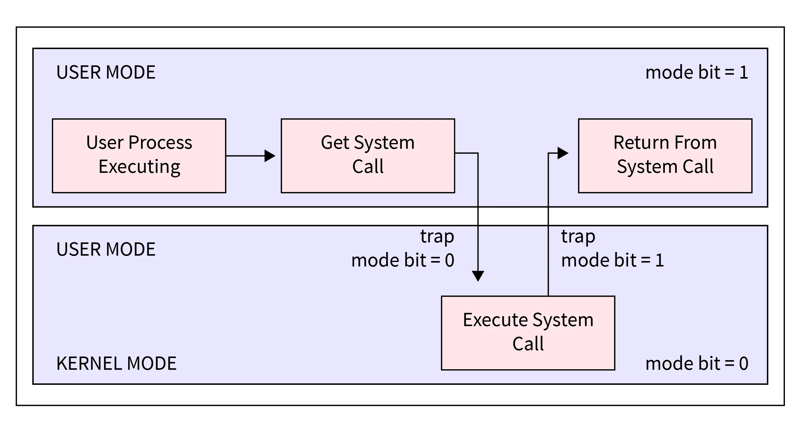
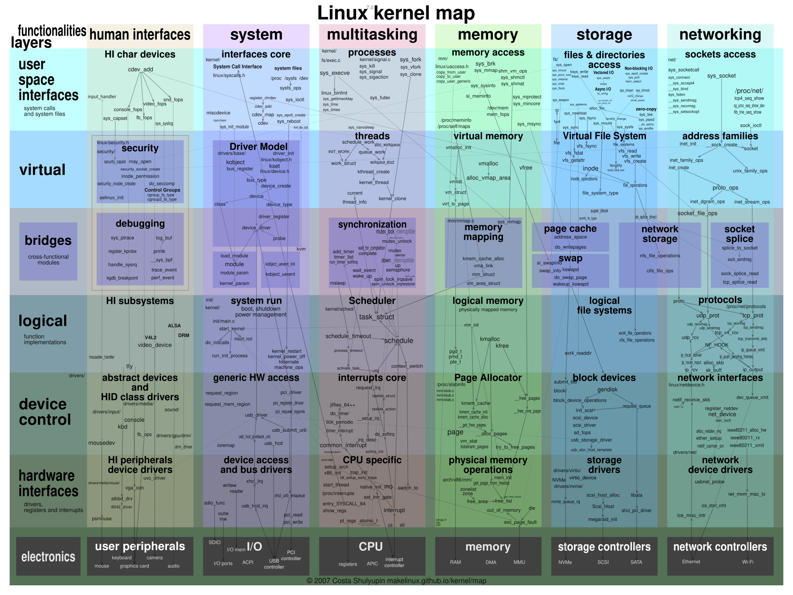
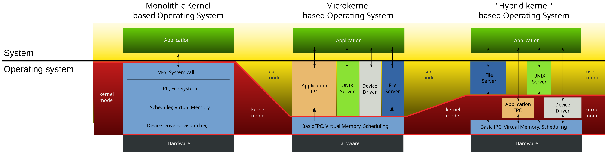

# Операционни системи - Компоненти

---

## Съдържание

- Ядро
- Драйвери
- Режими на работа
- Видове ядра
- Системни повиквания
- Потребителски интерфейс

---

## Припомняне - предишния урок

- ОС **опростява** хардуера, **разпределя** ресурсите и **изолира** програмите
- Ядрото е частта, която работи постоянно в привилегирован режим
- Компютърът стартира по реда: фърмуер -> boot loader -> ядро -> потребителски програми
- Програмите искат услуги от ядрото чрез системни извиквания
- Днес разглеждаме от какво се състои една ОС и как тези части си взаимодействат

---


**Фиг. 1 Структура на операционната система**

---

# Ядро

---

## Ядро

- Основната част на ОС - предоставя услуги на всички останали части
- Зареден е в защитена област на паметта, до която програмите нямат достъп
- Работи в привилегирован режим и има пълен достъп до хардуера
- Не е процес, който се изпълнява постоянно, а код, който се извиква при нужда
	- при системно извикване
	- при прекъсване от хардуера (например таймер)
	- при грешка в програма (например достъп до чужда памет)

---

## Ядро - Задачи

- Ядрото обединява функциите от предишния урок в няколко области:
	- **процеси и нишки** - създаване, планиране, прекратяване
	- **памет** - разпределяне на виртуалните адресни пространства, справяне с грешки при достъп
	- **файлова система** - файлове, директории, права за достъп
	- **устройства** - клавиатури, дискове, мрежови карти, дисплеи, USB
	- **мрежа** - комуникация между машини
	- **системни извиквания** - единствената врата към тези услуги за програмите

---

## Ядро - Пример в Linux

```bash
uname -r              # версията на ядрото
uname -a              # повече информация за системата
cat /proc/version     # как е компилирано ядрото
```

- Ядрото е обикновен файл на диска (в Linux най-често `/boot/vmlinuz-...`)
- Boot loader-ът го зарежда в паметта при стартиране

---

# Драйвери

---

## Драйвери

- Код, който позволява на ядрото да работи с конкретно устройство
	- принтери, графични карти, мрежови адаптери, дискове
- Крие разликите между устройствата зад еднакъв интерфейс
	- ядрото казва "прочети блок", драйверът знае как точно го прави това устройство
- Без драйвери ядрото трябва да знае как работи всеки модел устройство
- Най-често са част от ядрото или се добавят автоматично при инсталирането на ОС

---

## Драйвери - Пример

- HDD срещу SSD
- Устройствата имат напълно различен начин на работа, но вършат еднаква функция
- Програмата пише в един и същ файл, независимо от диска

---


**Фиг. 2 HDD срещу SSD**

---

## Драйвери - Видове

- Според типа на устройството:
	- **символни** - данните идват байт по байт: клавиатура, серийни портове, звукови карти
	- **блокови** - данните са на блокове с произволен достъп: твърди дискове, SSD, USB памет
	- **мрежови** - изпращат и получават пакети: мрежови карти
- Според мястото, където работят:
	- в ядрото - повечето драйвери
	- в потребителското пространство - при микроядрата и някои специални случаи

---

## Драйвери - Модули на ядрото

- В Linux драйверите могат да се зареждат и изваждат от работещото ядро като **модули**
	- не е нужно да се рестартира компютърът
	- ядрото не трябва да съдържа драйвери за всички възможни устройства

```bash
lsmod                 # заредените модули
modinfo <име>         # информация за модул
sudo modprobe <име>   # зареждане на модул
```

- Устройствата ще разгледаме подробно в темата за устройства (20)

---

# Режими на работа

---

## Режими на работа

- **Режим на ядрото** (привилегирован)
	- пълен достъп до хардуера и до цялата памет
	- работи ядрото, включително драйверите
- **Потребителски режим**
	- ограничен достъп - програмата вижда само собственото си адресно пространство
	- работят всички останали програми, включително шелът и графичният интерфейс
- Разделението е в самия процесор, не само в софтуера
	- специален бит показва в кой режим е процесорът в момента
	- привилегированите инструкции (например работа с устройства) в потребителски режим предизвикват грешка

---

## Превключване на режими

- Програмата в потребителски режим не може директно да извика функция на ядрото
- Превключването става само по контролиран начин:
	1. програмата изпълнява специална инструкция (**trap**) или възниква прекъсване
	2. процесорът превключва в режим на ядрото и скача на предварително зададен адрес в ядрото
	3. ядрото изпълнява искането
	4. ядрото връща управлението и процесорът се връща в потребителски режим
- Програмата не избира къде в ядрото да скочи, така че не може да заобиколи защитата

---



**Фиг. 3 Превключване между потребителски режим и режим на ядрото**
<!-- TODO: изображение - потребителски режим -> trap/системно извикване -> режим на ядрото -> връщане -->

---

# Видове ядра

---

## Видове ядра

- Различават се по това колко функции работят в режим на ядрото
- Три основни подхода:
	- **Монолитно ядро**
	- **Микроядро**
	- **Хибридно ядро**

---

## Монолитно ядро

- Всички основни услуги работят в един голям блок в режим на ядрото
	- планиране, памет, файлови системи, драйвери, мрежа
- Частите се извикат директно като функции - бързо
- Примери: Linux, класическите Unix и BSD системи
- Linux е монолитно ядро, но поддържа зареждане на модули

---



**Фиг. 4 Зареждаеми модули на ядрото (LKM)**

---

## Монолитно ядро - Недостатъци

1. голям размер на кода
2. трудно разширяване - всяка промяна засяга цялото ядро
3. по-лоша надеждност - грешка в един драйвер може да срине цялата система

---

## Микроядро

- Ядрото съдържа само най-необходимото
	- адресни пространства, базово планиране, комуникация между процеси
- Всичко останало работи в потребителски режим като нормални процеси - **сървъри**
	- файлова система, драйвери, мрежа
- Сървърите комуникират чрез **предаване на съобщения** през ядрото
- Примери: Minix, QNX, seL4

---

## Микроядро - Предимства и недостатъци

- Предимства
	- срив на драйвер не срутва ядрото - сървърът просто се рестартира
	- по-малко код в привилегирован режим - по-добра сигурност
	- лесно добавяне на услуги
- Недостатъци
	- по-бавно - всяка заявка минава през съобщения и повече превключвания на режим

---

## Хибридно ядро

- Комбинира двата подхода: микроядрена структура, но повече услуги в режим на ядрото за скорост
- Примери: Windows (NT), macOS (XNU)

---



**Фиг. 5 Видове ядра**

---

# Системни повиквания

---

## Системни повиквания

- Единственият контролиран начин, по който програмата иска услуга от ядрото
- Ядрото ги предоставя като набор от функции с номера
	- Linux има няколкостотин системни извиквания
- Могат да бъдат извикани от C, C++, Assembly и др.
- Вече видяхме `open`, `write` и `close` от `io.c` - ето какво се случва в цялата програма

---


**Фиг. 6 Пример за системни извиквания**

---

## API

- **Application Programming Interface**
- Дефинира функциите, до които програмистът има достъп
- Опростява повикванията, които трябва да се правят
- Достъпва се чрез библиотека от код (например libc)

---

## Популярни API-та

- Windows API - за Windows системи
- POSIX API - за Linux, macOS и други Unix-подобни системи
- Java API - за програми, които се стартират на JVM

---

## API - Предимства

- Често функция от API-то просто извиква съответното системно повикване (напр. `CreateProcess` извиква `NtCreateProcess` при Windows)
- Често функцията прави и допълнителна работа
	- пример: `printf` форматира текста, буферира го и чак тогава вика `write`
- Това предоставя по-голяма преносимост на кода
- Пример: Linux и macOS имат различни системни повиквания, но предоставят едно и също POSIX API

---

## API и системно извикване

```c
#include <unistd.h>
#include <sys/syscall.h>

int main() {
    write(1, "hi\n", 3);              // функция от libc
    syscall(SYS_write, 1, "hi\n", 3); // директно системно извикване (Linux)
    return 0;
}
```

- И двата реда правят едно и също - изписват "hi" на екрана (дескриптор 1)
- Програмистите почти винаги ползват първия вариант
- Проверка: `strace ./program` показва два `write` в изхода

---

## System-call-interface

- Връзка между API и системните повиквания
- Засича извиквани API функции и извиква нужни системни повиквания
- Всяко системно повикване има номер - интерфейсът го използва като индекс в таблица на ядрото
- Потребителите трябва само да знаят API функциите, вместо системните

---


**Фиг. 7 Интерфейс на системните извиквания**

---

## Системни повиквания - параметри

- Могат да се предават в:
	- регистрите - най-бързо, но е ограничено по брой
	- блок от паметта - в регистър се предава адресът на блока
	- програмния стек
- Linux и Windows предпочитат блок или регистри

---


**Фиг. 8 Пример за предаване на параметри**

---

## Типове системни повиквания

- 6 основни вида:
	- управление на процеси
	- управление на файлове
	- управление на устройства
	- поддържане на информация
	- комуникация
	- защита
- Имената по-долу са общи. В скоби е реалното име в Linux/POSIX

---

## Управление на процеси

- Приключване (`end()`, `abort()`) - `exit()`
- Създаване и прекратяване на процеси (`create_process()`, `terminate_process()`) - `fork()`, `kill()`
- Зареждане и изпълнение на програма (`load()`, `execute()`) - `execve()`
- Изчакване на време или събитие (`wait_time()`, `wait_event()`) - `wait()`, `sleep()`
- Сигнализиране на събитие (`signal_event()`) - `kill()`
- Определяне на качествата на процес (`get_process_attributes()`, `set_process_attributes()`) - `getpid()`, `nice()`

---

- Заделяне и освобождаване на памет - `brk()`, `mmap()`
- Заключване и отключване на данни

---

## Управление на файлове

- Създаване и триене (`create()`, `delete()`) - `open()` с `O_CREAT`, `unlink()`
- Отваряне и затваряне (`open()`, `close()`) - същите
- Четене и писане (`read()`, `write()`) - същите
- Навигиране (`reposition()`) - `lseek()`
- Определяне на качествата (`get_file_attributes()`, `set_file_attributes()`) - `stat()`, `chmod()`

---

## Управление на устройства

- Искане и освобождаване (`request()`, `release()`) - `open()`, `close()`
- Четене, писане, навигиране (`read()`, `write()`, `reposition()`)
- Определяне на качествата (`get_device_attributes()`, `set_device_attributes()`) - `ioctl()`
- Устройствата в Linux са представени като файлове (`/dev`), затова се ползват същите извиквания

---

## Поддържане на информация

- Текущо време и дата (`time()`, `date()`) - `time()`, `gettimeofday()`
- Информация за процеси, файлове или устройства - `getpid()`, `stat()`, `uname()`

---

## Комуникация

- Създаване и триене на връзки - `socket()`, `connect()`, `close()`
- Изпращане и получаване на съобщения - `send()`, `recv()`, `pipe()`
- Споделяне на памет - `shmget()`, `mmap()`

---

## Защита

- Управляване на достъп до ресурси - `chmod()`, `chown()`
- Променяне или получаване на привилегиите на даден ресурс - `setuid()`
- Даване или отказване на достъп на даден потребител
- Ще ги разгледаме в темата за права за достъп (07)

---

# Потребителски интерфейс

---

## Потребителски интерфейс

- Позволява на потребителя да взаимодейства с компютъра
- Не е част от ядрото - това са обикновени програми в потребителски режим
	- използват системни извиквания като всички останали
- Може да бъде команден и графичен

---

## Команден интерфейс

- Потребителят въвежда команди, които компютърът да изпълнява
- Програмата, която ги приема, се нарича **шел** (**shell** - обвивка) или команден интерпретатор
- Примери: bash, zsh, fish, ...
- Шелът чете командата, създава нов процес (`fork()`) и стартира програмата в него (`execve()`)
	- така се стартира `./main` от предишния урок

```bash
echo $SHELL     # кой шел използвам
```

---


**Фиг. 9 Пример за терминал**

---

## Графичен интерфейс

- Потребителят навигира чрез мишка или жестове различни прозорци и менюта
- Файлове, програми и папки са представени чрез икони
- Примери: GNOME, KDE, Windows UI
- В Linux е отделна програма от ядрото - може да се сменя или да липсва (сървъри)

---


**Фиг. 10 Пример за десктоп среда**

---

## Интерфейси - Разлики

- Графичните интерфейси са по-лесни за използване
- Командните интерфейси са по-мощни
	- могат да се автоматизират чрез скриптове
	- работят и през мрежа (SSH), и на машини без екран
- В курса ще работим основно с командния интерфейс

---

## Обобщение

- **Ядрото** управлява процеси, памет, файлове, устройства и мрежа в привилегирован режим
- **Драйверите** крият разликите между устройствата зад общ интерфейс
- **Режимите** на работа налагат изолацията - преминаването между тях става само чрез trap
- **Видовете ядра** (монолитно, микро, хибридно) се различават по това какво работи в режим на ядрото
- **Системните повиквания** са вратата към ядрото, а **API** е удобният слой над тях
- **Интерфейсът** (шел или графичен) е обикновена програма в потребителски режим
- Следва: Linux - конкретна ОС, която ще използваме в курса

---

## Въпроси

- Защо програма в потребителски режим не може да вика директно функции на ядрото?
- Каква е разликата между API и системно извикване? Дайте пример
- Какво ще стане със системата при срив на драйвер в монолитно ядро и в микроядро?
- Защо Linux е монолитно ядро, но може да зарежда модули?
- Кои системни извиквания прави `cat file.txt`? Как да го проверим?
- Защо шелът не е част от ядрото?

---
