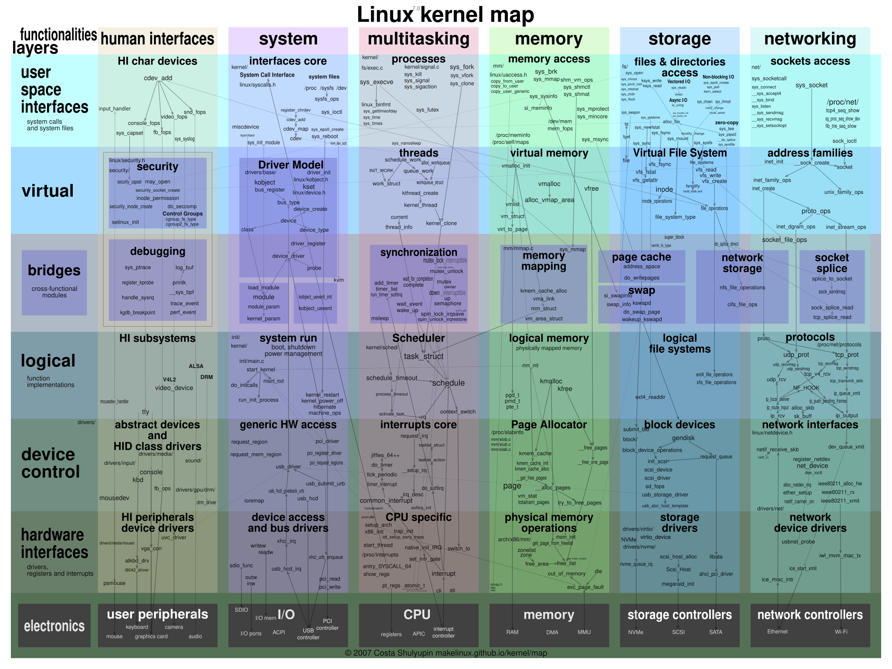
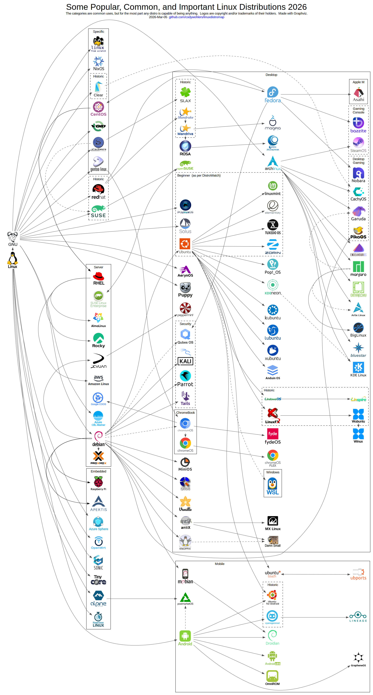

# Linux

---
## Съдържание

- Какво е Linux?
- История на Linux
- Лиценз
- Linux дистрибуции
- Предимства и недостатъци

---

## Припомняне - предишните уроци

- ОС **опростява** хардуера, **разпределя** ресурсите и **изолира** програмите
- **Ядро** - програмата, която управлява хардуера; **ОС** - ядро плюс основни програми и библиотеки; **дистрибуция** - готов пакет от ядро, програми и инсталатор
- Ядрото на Linux е монолитно, но зарежда драйверите като модули
- Стартиране: фърмуер -> boot loader -> ядро -> първата потребителска програма
- Днес разглеждаме Linux - ОС, с която ще работим в курса

---
## Какво е Linux?

- Семейство от операционни системи, които са базирани на Linux ядрото
- Многозадачна и многопотребителска
- С общо предназначение

---


**Фиг. 1 Пингвинът Tux**

---
## Linux, GNU/Linux и дистрибуция

- **Linux** - строго погледнато, само ядрото
- **GNU/Linux** - ядрото плюс системните програми и библиотеки от проекта GNU
- **Дистрибуция** - GNU/Linux, събран с инсталатор, пакетен мениджър и приложения (Ubuntu, Debian, Fedora, Arch)
- В ежедневието "Linux" се използва и за трите

```bash
cat /etc/os-release   # коя дистрибуция е това
uname -r              # коя версия на ядрото
```

---
## Linux ядро

- Основният компонент на операционната система
- Управлява процесите, паметта, файловата система, устройствата и мрежата (виж урок 3)
- Предоставя системните извиквания, чрез които програмите ползват тези услуги
- Написано главно на C (и малко на Rust)
- Развива се от общност от хиляди разработчици, много от които са служители на компании (Intel, Google, Red Hat, ...)

---

## Linux ядро - Архитектура

- Монолитно ядро - всички основни услуги работят в режим на ядрото
- Драйверите се зареждат като **модули** (`lsmod`, `modprobe`)
- Ядрото е файл на диска (`/boot/vmlinuz-...`), който boot loader-ът зарежда в паметта



**Фиг. 2 Зареждаеми модули на ядрото (LKM)**

---
## Linux ядро - Версии

- Всяка версия има три компонента:
    - **major** номер
    - **minor** номер
    - **revision** (patch) номер
- Пример: 6.11.2

```bash
uname -r    # пример за изход: 6.11.2-arch1-1
```

---

- Историческа бележка: до версия 2.6 четен **minor** номер означава стабилна, а нечетен - тестова версия. Тази схема вече не се използва
- Днес клоновете са:
    - **mainline** - новите функции; излиза нова версия на всеки 2-3 месеца
    - **stable** - mainline версия, на която се пускат поправки
    - **LTS** (long-term support) - версии с поддръжка няколко години; ползват се от сървъри и дистрибуции
- Една версия може да има десетки и стотици ревизии (поправки на грешки)

---

# История

---

## Unix

- Създадена в Bell Labs през 1969 г. от Кен Томпсън и Денис Ричи
- Пренаписана на C, което я прави лесно преносима между различни машини
- Комерсиална ОС, използвана от университети и големи корпорации
- Появяват се много разклонения - например BSD (Бъркли)
- **POSIX** - стандарт за интерфейса на Unix-подобните системи (виж урок 3)

---


**Фиг. 3 История на Unix**
<!-- TODO: изображение - времева линия: Unix (1969) -> BSD, System V -> POSIX (1988) -> MINIX (1987) -> Linux (1991) -->

---

## Хакерска култура

- **Хакер**: Човек, който иска да разшири знанията си за компютри чрез експериментиране
- Много от хакерите от това време са инженери или учени, т.е са запознати с UNIX

---

## Ричард Столман

- Основател на **Free Software Foundation** (1985)
- Вярва, че софтуерът трябва да може да се споделя свободно
- UNIX е в конфликт с тази идея

---


**Фиг. 4 Ричард Столман**

---

## Свободен софтуер

- Четири свободи на потребителя:
    1. да стартира програмата за каквато и да е цел
    2. да изучава и променя изходния код
    3. да разпространява копия
    4. да разпространява променените версии
- Свободен не означава безплатен ("free as in freedom, not free beer")

---

## GNU  Project

- **GNU is Not UNIX**
- Проект, започнат през 1983 г., за създаване на напълно свободна Unix-подобна операционна система
- GNU General Public License (GPL)
- До началото на 90-те GNU има почти всичко: компилатор (gcc), шел (bash), системни програми (coreutils), библиотека (glibc)
- Липсва му само ядро - неговото ядро (Hurd) така и не става готово за масова употреба

---


**Фиг. 5 GNU лого**

---
## MINIX

- Учебна Unix-подобна ОС с **микроядро** (виж урок 3), създадена от Андрю Танънбаум през 1987 г.
- Кодът ѝ се използва само в учебни цели - не може свободно да се разпространява и променя
- Именно нея използва студентът Линус Торвалдс като основа

---

## Linux

- През 1991 г. Линус Торвалдс започва да пише собствено ядро като хоби, защото MINIX не му е достатъчен
- Публикува го под GPL лиценз, така че всеки да може да го ползва и подобрява
- Свързано с GNU софтуера, ядрото дава първата напълно свободна и работеща операционна система
- Linux след това става фокусна точка на свободният софтуер

---

## Дебатът Танънбаум - Торвалдс

- През 1992 г. Танънбаум критикува Linux, че е монолитно ядро - според него микроядрата са бъдещето
- Торвалдс защитава монолитния подход заради простота и скорост
- Спорът "монолитно или микроядро" (урок 3) е жив и до днес
- Историята показва, че и двата подхода работят

---


**Фиг. 6 Линус Торвалдс**

---
## GNU/Linux

- Операционна система, която използва:
    - Linux ядрото
    - Системен софтуер и библиотеки, предоставени от GNU (glibc, gnu coreutils, ...)
- Затова някои настояват системата да се нарича **GNU/Linux**

---

# Лиценз

---

## Linux - Лиценз

- [Софтуер с отворен код](https://opensource.org/osd) (OSS) - изходният код е достъпен за всички
- Използва [GPL-2.0](https://git.kernel.org/pub/scm/linux/kernel/git/torvalds/linux.git/tree/LICENSES/preferred/GPL-2.0) лиценз
- Една от причините Linux да е предпочитан от компании и потребители
- Кодът на ядрото е достъпен на [kernel.org](https://www.kernel.org/)

---

## GPL - Copyleft

- Може свободно да ползваш, променяш и разпространяваш кода
- Ако разпространяваш променена версия, трябва да я издадеш под същия лиценз и да предоставиш изходния код
- Така свободата се запазва и за следващите потребители
- Различните лицензи имат различни правила (например MIT е много по-свободен)

---

## Свободен софтуер и OSS

- **Свободен софтуер** (FSF) - акцентът е върху свободите на потребителя
- **Софтуер с отворен код** (OSS) - акцентът е върху практическите предимства на отворената разработка
- На практика почти всеки лиценз попада и в двете, затова често се пише FOSS

---

## OSS – Предимства

- разпространено сътрудничество
- бързо забелязване и коригиране на грешки
- функциите се развиват според потребителските нужди

---

# Дистрибуции

---

## Linux From Scratch

- Компилираме, инсталираме и конфигурираме всичките компоненти сами
- Ядро => Системни програми => Потребителски програми
- Не се препоръчва за повечето случаи

---

## Linux Дистрибуция

- Операционна система, основана върху Linux ядрото
- Готов пакет от ядро, програми и инсталатор (виж урок 2)
- Значително улеснява използването на Linux по следните начини:

---
## 1. Инсталация

- Базовите компоненти  (ядро, системни функции, потребителски програми) са предварително конфигурирани
- Тези програми са често в бинарен изпълним формат
- Повечето дистрибуции предлагат автоматизирани инсталатори

---
## 2. Управление на процеси

- Припомняне: ядрото стартира първата потребителска програма
- **init** система - първият процес (с PID 1), контролира всички други процеси
- Дистрибуцията предварително конфигурира init системата
- Популярни init системи в Linux - **systemd**, openrc, runit

```bash
ps -p 1     # кой е първият процес
```

---
## 3. Управление на софтуер

- Потребителят няма нужда сам да си компилира програмите
- Софтуерът се организира в пакети, които операционната система управлява чрез **пакетен мениджър**

---
## Пакет

- Програмният софтуер, заедно с важни метаданни (име, версия, зависимости, ...)
- Пакетите често се пазят в общо хранилище
- Софтуер, който не се намира в хранилището трябва да се инсталира ръчно

---
## Пакетен мениджър

- Програма, която отговаря за изтеглянето, актуализирането и триенето на пакети
- Обикновена програма в потребителски режим - използва системни извиквания като всяка друга
- Популярни пакетни мениджъри (apt, dnf, pacman)

---

## Пакетни мениджъри - Примери

| Семейство | Пакетен мениджър | Примери за дистрибуции |
| --------- | ---------------- | ---------------------- |
| Debian    | apt              | Debian, Ubuntu, Mint   |
| Red Hat   | dnf              | Fedora, RHEL, Rocky    |
| Arch      | pacman           | Arch, Manjaro          |

```bash
sudo apt install htop      # Debian/Ubuntu
sudo dnf install htop      # Fedora
sudo pacman -S htop        # Arch
```

---
## 4. Потребителски интерфейс

- Повечето дистрибуции идват с **desktop environment** (графичен интерфейс и допълнителни полезни приложения)
- Както в урок 3, той е обикновена програма, а не част от ядрото - затова може да се сменя или да липсва (сървъри)
- Популярни десктопи: GNOME, KDE, XFCE, ...

---

## Видове дистрибуции

- **Fixed Release** - Издават нова версия през определен период
- **Rolling Release** - Постоянно издават ъпдейти

---
## Fixed release

- Промени в основните компоненти на системата (ядро, desktop, приложения ...) се правят чрез нова версия
- Всички промени се тестват добре преди да са издадени и осигуряват стабилен UX
- Потребителите нямат достъп до най-новите пакети
- Много дистрибуции предлагат **LTS** версии с дълга поддръжка (например Ubuntu LTS)

---


**Фиг. 7 Ubuntu**

---


**Фиг. 8 Debian**

---


**Фиг. 9 Fedora**

---
## Rolling release

- Дистрибуцията няма различни версии, нови промени се въвеждат постоянно
- Потребителят има достъп до най-новите пакети, но някои ъпдейти могат да счупят системата

---


**Фиг. 10 Arch Linux**

---

## Rolling vs Fixed

- Fixed - за потребители, които искат стабилен UX, без допълнителни усилия, както и за сървъри
- Rolling - за потребители, които знаят какво правят и искат достъп до най-новият софтуер

---



**Фиг. 11 Дърво на дистрибуциите**

---

# Предимства и недостатъци

---

## Linux - Популярност

- Десктоп: около 4% пазарен дял (2024)
- Сървъри и облак: огромното мнозинство
- Суперкомпютри: всички от Top500
- Android използва Linux ядрото - милиарди устройства
- Вградени системи: рутери, телевизори, автомобили

---
## Linux - Предимства

- Намаляване на риска
- Задоволяване на нуждите на бизнеса
- Стабилност и сигурност
- Гъвкавост за различни хардуерни платформи

---

- Лесно персонализиране
- Лесно получаване на подкрепа
- Намаляване на разходите

---

## Намаляване на риска

- изпълнение на критични задачи (бази данни, e-търговия, манипулиране на данни)
- софтуерът често трябва да се промени заради нуждите в пазара
- това може да е скъпо и рисковано

---
## Намаляване на риска - Сценарий

- ABC Inc. купува софтуер от ACME Inc., за да проследява информация за продажбите и потребителите си през Интернет.
- Какво ще стане ако ACME Inc. прекрати дейността си или спира поддръжка на продаденият продукт.

---

- Ако вместо това ABC избере да използва OSS продукт и първоначалните разработчици станат недостъпни за поддръжката му, тогава ABC ще бъде свободен да вземе изходния код, да добави функции към него и да го поддържа сами.

---

## Задоволяване на бизнес нужди

- Linux е добра база за други OSS проекти, които задоволяват всякакви потребителски нужди. Този софтуер може да включва:
    - Бази данни
    - Офис пакети
    - Браузъри
    - ...

---

## Стабилност и сигурност

- Софтуерът е свободно достъпен за всички
- Ако в софтуерът има бъг, шансът той да се открие и да се отстрани е увеличен
- При софтуер със затворен код потребителят трябва да разчита на доставчика

---

- Отвореният код не гарантира сигурност - грешките трябва реално да бъдат прегледани
    - пример: през 2024 г. в библиотеката `xz` е открит умишлено вграден backdoor
- Сигурността на Linux идва и от изолацията от урок 2 и 3: режими на работа, права на потребителите, процеси със собствено адресно пространство
- Linux десктопите са по-малка мишена заради ниския пазарен дял
- Linux сървърите са голяма мишена, защото на тях работи голяма част от интернет

---

## Гъвкавост

- x86/64 и ARM
- стари компютри и суперкомпютри
- смартфони, таблети
- [Космически кораби](https://thenewstack.io/the-hardware-and-software-used-in-space/), Четци, Рутери, ...
- Пример за целта "преносимост" от урок 2

---

## Лесно персонализиране

- различни части на операционната система могат да бъдат персонализирани спрямо потребителските нужди
- това най-често включва компилирането на различни модули на ядрото и инсталираните пакети

---

## Пример за Linux Desktop

- Графичен интерфейс, пакети, които потребителят ще използва всекидневно (браузър, офис пакет, снимки, ...)
- Драйвери устройства, които потребителят ще използва (Wi-Fi, Bluetooth, Графики, ...)
- Потребителят може да си [персонализира работата](https://www.reddit.com/r/unixporn/)

---

## Пример за Linux Сървър

- Ще включва единствено пакетите, нужни на сървъра да си изпълнява задачите
- Включени драйвери ще бъдат значително ограничени
- Така сървърът ще има нужда от по-малко пространство и ще бъде по-бърз

---
## Лесна подкрепа

- Цялата Linux документация се предлага безплатно в Интернет
- Популярни източници: [Arch Wiki](https://wiki.archlinux.org/title/Main_page), [LDP](https://tldp.org/), [linux.die.net](https://linux.die.net), ...
- Предлага се и [професионална подкрепа](https://www.redhat.com/en/technologies/linux-platforms/enterprise-linux)
- Вградена документация: `man <команда>`

---
## Намаляване на разходи

- Разходи като добиване на софтуер (безплатно), купуване на подходящ хардуер, наемане на хора за поддръжка.
- За лична употреба: "Linux е безплатен ако не си цениш времето."
- Цената включва и обучение - общата цена на притежание (TCO) не е нула

---

| Операционна система           | Linux | ОС със затворен код |
| ----------------------------- | ----- | ------------------- |
| Цена на операционната система | 0$    | > 0$                |
| Административни разходи       | Ниски | Умерени/високи      |

---

| Операционна система              | Linux         | ОС със затворен код |
| -------------------------------- | ------------- | ------------------- |
| Цената на допълнителен софтуер   | Ниска/Никаква | Висока              |
| Цената на софтуерните надстройки | Ниска/Никаква | Умерена/висока      |

---

## Linux - Недостатъци

- **Съвместимост на софтуера** - някои професионални програми и игри нямат Linux версия
- **Фрагментация** - много дистрибуции, пакетни мениджъри и десктопи
- **Крива на учене** - особено при работа през командния ред
- **Поддръжка на хардуер** - някои производители не предоставят драйвери за Linux
- Изборът зависи от задачата - Linux не е най-доброто решение във всяка ситуация

---

## Обобщение

- **Linux** е ядро; **GNU/Linux** е ОС; **дистрибуцията** е готов пакет за ползване
- Историята: Unix -> GNU (свободен софтуер) -> MINIX -> Linux ядро (1991)
- Ядрото е монолитно с модули, лицензирано под **GPL** (copyleft)
- Дистрибуциите предоставят инсталация, init система, пакетен мениджър и интерфейс
- **Fixed** дистрибуциите са стабилни, **Rolling** - винаги с най-новото
- Linux има предимства (цена, гъвкавост, отворен код), но и недостатъци (съвместимост, фрагментация)
- Следва: работа с Linux - командният ред и файловата система

---

## Въпроси

- Каква е разликата между Linux, GNU/Linux и дистрибуция?
- Защо Линус Торвалдс създава Linux, а не ползва GNU Hurd или MINIX?
- Какво означава copyleft и как се различава GPL от MIT?
- Как се стига до първия процес (init) при стартиране на Linux?
- Защо пакетният мениджър не е част от ядрото?
- Кога бихте избрали Fixed и кога Rolling дистрибуция?
- Дайте пример, когато Linux не е добър избор

---
