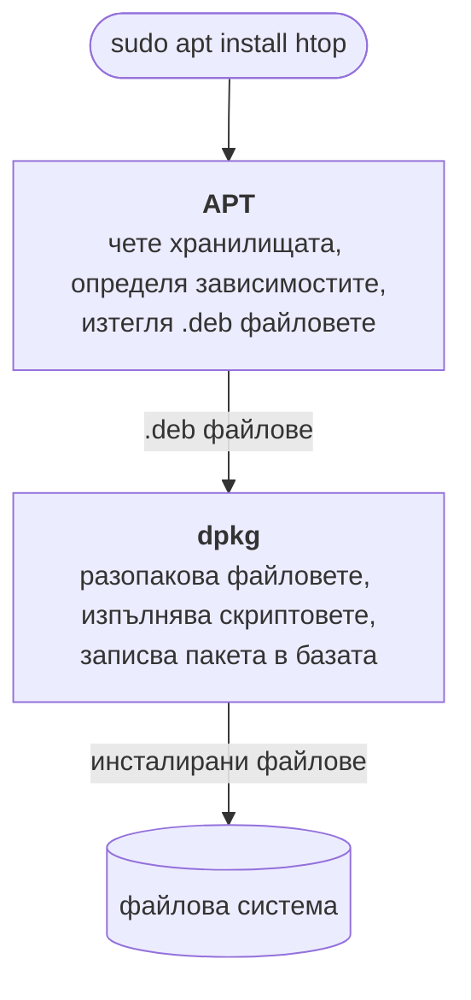

# Работа с пакети

---
## Съдържание

- Управление на софтуер чрез пакети
- APT
- dpkg
- Какво съдържа един `.deb` пакет?
- Универсални пакетни мениджъри
- Snap
- Сравнение

---
## Управление на софтуер чрез пакети

- В Linux софтуерът обикновено не се изтегля ръчно от сайтове, а се инсталира като **пакети**
- Системата знае какво е инсталирано и може да го обновява и премахва на едно място
- Три основни понятия: **пакет**, **пакетен мениджър** и **хранилище**

---
### Пакет

- Файл, който съдържа програмата, заедно с **метаданни**:
    - име и версия
    - архитектура, за която е компилирана
    - **зависимости** — други пакети, без които програмата не може да работи
- Форматът зависи от семейството дистрибуции: `.deb` (Debian, Ubuntu), `.rpm` (Fedora, RHEL)

---
### Пакетен мениджър

- Програма за инсталиране, обновяване и премахване на пакети
- Разрешава зависимостите автоматично
- Пази информация кои пакети и файлове са инсталирани
- Примери: `apt`, `dnf`, `pacman`

---
### Хранилище

- Сървър (repository), на който се съхраняват пакети и списък с наличните им версии
- Поддържа се най-често от самата дистрибуция, което дава проверен и съвместим софтуер
- В Debian/Ubuntu хранилищата се настройват в `/etc/apt/sources.list` и `/etc/apt/sources.list.d/`

---
### Как работят заедно?

1. Потребителят поисква пакет от пакетния мениджър
2. Мениджърът го намира в хранилището и определя зависимостите му
3. Изтегля всички нужни пакети
4. Инсталира ги и записва какво е добавено в системата

---
## APT

- **Advanced Package Tool**
- Основният пакетен мениджър в Debian/Ubuntu базирани дистрибуции
- Работи с `.deb` пакети

---
### Основни команди

```bash
# Обновяване на списъка с пакети
$ sudo apt update

# Обновяване на инсталираните пакети
$ sudo apt upgrade

# Инсталиране на пакет
$ sudo apt install <пакет>

# Премахване на пакет
$ sudo apt remove <пакет>

# Премахване заедно с конфигурационните файлове
$ sudo apt purge <пакет>

# Търсене на пакет
$ apt search <ключова_дума>

# Информация за пакет
$ apt show <пакет>

# Премахване на неизползвани зависимости
$ sudo apt autoremove
```

---
## dpkg

- Основният инструмент за работа с `.deb` файлове
- APT използва dpkg в основата си
- Подходящ за ръчна инсталация на локални пакети

```bash
# Инсталиране на локален .deb файл
$ sudo dpkg -i package.deb

# Премахване на пакет
$ sudo dpkg -r <пакет>

# Списък на инсталираните пакети
$ dpkg -l

# Проверка дали пакет е инсталиран
$ dpkg -l <пакет>

# Файловете, инсталирани от пакет
$ dpkg -L <пакет>
```

---
### Разлика между APT и dpkg

- **dpkg** работи на **ниско ниво** — с конкретен `.deb` файл, който вече е на компютъра
    - разопакова файловете и изпълнява инсталационните скриптове
    - пази базата с инсталирани пакети (`/var/lib/dpkg/`)
    - **не** изтегля пакети и **не** инсталира зависимости
- **APT** работи на **високо ниво** — с хранилищата
    - намира пакетите и изчислява зависимостите
    - изтегля нужните `.deb` файлове и ги подава на dpkg

---
### Как се свързват?



---
### Локален пакет със зависимости

- dpkg само съобщава за липсваща зависимост и оставя пакета неконфигуриран

```bash
$ sudo dpkg -i app.deb
dpkg: dependency problems prevent configuration of app:
 app depends on libfoo; however:
  Package libfoo is not installed.

# Инсталиране на липсващите зависимости
$ sudo apt install -f
```

- APT може да инсталира и локален файл, заедно със зависимостите му:

```bash
$ sudo apt install ./app.deb
```

- `./` е задължително — иначе APT търси пакет с това име в хранилищата

---
## Какво съдържа един `.deb` пакет?

- `.deb` файлът е архив във формат `ar` с три компонента:
    - `debian-binary` — версията на формата
    - `control.tar.*` — метаданни и инсталационни скриптове
    - `data.tar.*` — файловете, които ще се инсталират
- Разширението на архивите зависи от компресията (`.xz`, `.zst`, `.gz`)

```bash
$ ar t hello-os_1.0_all.deb
debian-binary
control.tar.xz
data.tar.xz
```

---
### `control.tar.*`

- `control` — задължителен файл с метаданните на пакета
- Незадължителни скриптове, които dpkg изпълнява автоматично:
    - `preinst` / `postinst` — преди / след инсталиране
    - `prerm` / `postrm` — преди / след премахване

### `data.tar.*`

- Файловете на програмата с пътищата им спрямо `/`
- Например `./usr/bin/hello-os` се инсталира като `/usr/bin/hello-os`

---
### Разглеждане на `.deb` пакет

```bash
# Метаданни на пакета
$ dpkg-deb -I package.deb

# Списък с файловете в пакета
$ dpkg-deb -c package.deb

# Разопаковане на файловете в директория
$ dpkg-deb -x package.deb <директория>
```

- Нито една от тези команди не инсталира пакета

---
### Как да пакетираме наш софтуер?

1. Създаваме директория, която повтаря структурата на файловата система
2. Поставяме файловете на програмата в нея (напр. в `usr/bin/`)
3. Добавяме файл `DEBIAN/control` с метаданните
4. Изграждаме пакета с `dpkg-deb --build`

- Прието е файлът да се именува `<име>_<версия>_<архитектура>.deb`
- Пакетите за официалните хранилища се изграждат с по-сложни инструменти (`debhelper`, `dpkg-buildpackage`)

---
### Пример: структура на пакета

- Ще пакетираме проста програма `hello-os`

```text
hello-os_1.0_all/
├── DEBIAN/
│   └── control
└── usr/
    └── bin/
        └── hello-os
```

```bash
$ mkdir -p hello-os_1.0_all/DEBIAN hello-os_1.0_all/usr/bin
```

---
### Пример: програмата

Файл `hello-os_1.0_all/usr/bin/hello-os`:

```bash
#!/bin/bash
echo "Здравей от моя .deb пакет!"
```

Правим файла изпълним:

```bash
$ chmod 755 hello-os_1.0_all/usr/bin/hello-os
```

---
### Пример: метаданните

Файл `hello-os_1.0_all/DEBIAN/control`:

```text
Package: hello-os
Version: 1.0
Architecture: all
Maintainer: Ivan Ivanov <ivan@example.com>
Depends: bash
Description: Simple example package
```

- `Architecture: all` — пакетът работи на всяка архитектура, защото е скрипт
- `Depends` — зависимостите, които APT ще инсталира автоматично
- Файлът трябва да завършва с нов ред

---
### Пример: изграждане и инсталиране

```bash
# Изграждане на пакета
$ dpkg-deb --build --root-owner-group hello-os_1.0_all
dpkg-deb: building package 'hello-os' in 'hello-os_1.0_all.deb'.

# Инсталиране
$ sudo apt install ./hello-os_1.0_all.deb

# Изпълнение
$ hello-os
Здравей от моя .deb пакет!

# Премахване
$ sudo apt remove hello-os
```

- `--root-owner-group` задава `root` за собственик на файловете в пакета

---
## Универсални пакетни мениджъри

---
### Проблеми с класическите пакетни мениджъри

- **Обвързаност с дистрибуцията** — един и същ софтуер трябва да се пакетира отделно за всяко семейство дистрибуции
- **Споделени зависимости** — приложения, които изискват различни версии на една библиотека, може да влязат в конфликт (*dependency hell*)
- **Остарял софтуер** — при fixed release дистрибуциите версиите в хранилищата остават замразени
- **Липса на изолация** — приложенията имат достъп до всичко, до което има достъп потребителят

---
### Какво представляват?

- Пакетни мениджъри, чиито пакети работят на **много различни дистрибуции**
- Пакетът носи зависимостите си със себе си или ползва общ **runtime**, независим от дистрибуцията
- Работят **наред** с класическия пакетен мениджър, а не вместо него

| Формат   | Разработен от | Източник       | Особеност                           |
|----------|---------------|----------------|-------------------------------------|
| Snap     | Canonical     | Snap Store     | Приложения за десктоп и сървър      |
| Flatpak  | Общността     | Flathub        | Основно приложения за десктоп       |
| AppImage | Общността     | Сайт на автора | Един изпълним файл, без инсталиране |

---
### Как решават проблемите?

| Проблем                     | Решение                                                              |
|-----------------------------|----------------------------------------------------------------------|
| Обвързаност с дистрибуцията | Един пакет работи на различни дистрибуции                            |
| Споделени зависимости       | Всяко приложение ползва свои версии на библиотеките                  |
| Остарял софтуер             | Авторът публикува нови версии директно, независимо от дистрибуцията  |
| Липса на изолация           | Приложението работи в **sandbox** с ограничени права (Snap, Flatpak) |

---
### Каква е цената?

- По-големи пакети, защото библиотеките се дублират
- По-бавно стартиране при някои формати
- Изолацията може да ограничи достъпа до файлове и устройства
- Библиотеките се обновяват от автора на пакета, а не централно от дистрибуцията

---
## Snap

- Разработен от Canonical и инсталиран по подразбиране в Ubuntu
- Пакетите се разпространяват през **Snap Store**
- Фоновата услуга `snapd` управлява пакетите и ги **обновява автоматично**
- Всеки пакет е файл `.snap`, който се монтира само за четене в `/snap/<пакет>/`

---
### Основни команди

```bash
# Търсене на пакет
$ snap find <пакет>

# Инсталиране
$ sudo snap install <пакет>

# Обновяване
$ sudo snap refresh <пакет>

# Премахване
$ sudo snap remove <пакет>

# Връщане към предишната версия
$ sudo snap revert <пакет>

# Списък на инсталираните snap пакети
$ snap list
```

---
## Сравнение

| Характеристика   | APT              | dpkg             | Snap             |
|------------------|------------------|------------------|------------------|
| Зависимости      | Автоматично      | Ръчно            | Вградени         |
| Формат           | .deb             | .deb             | .snap            |
| Изолация         | Не               | Не               | Да               |
| Хранилище        | Централно        | Локален файл     | Snap Store       |
